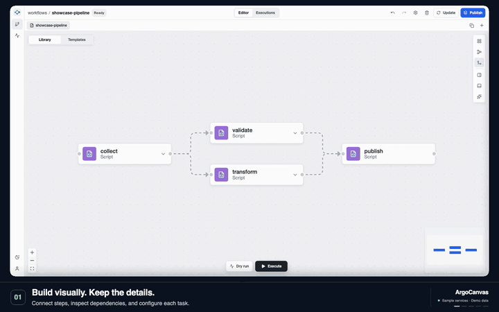
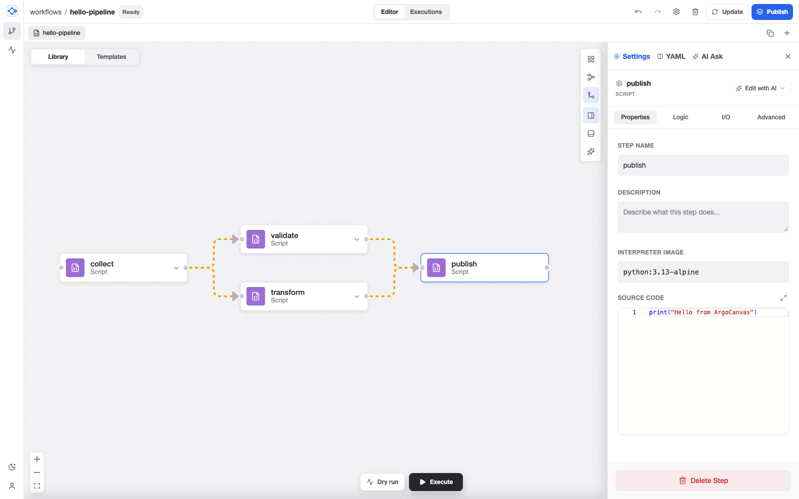
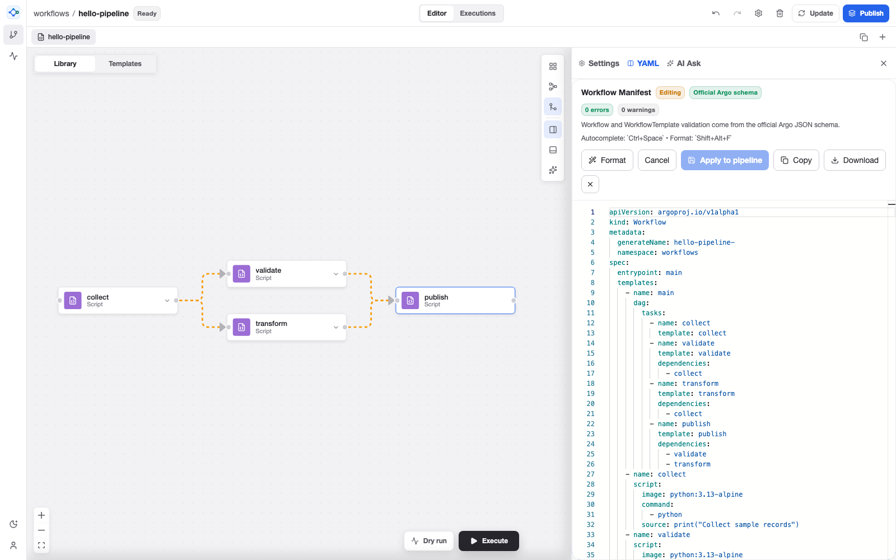
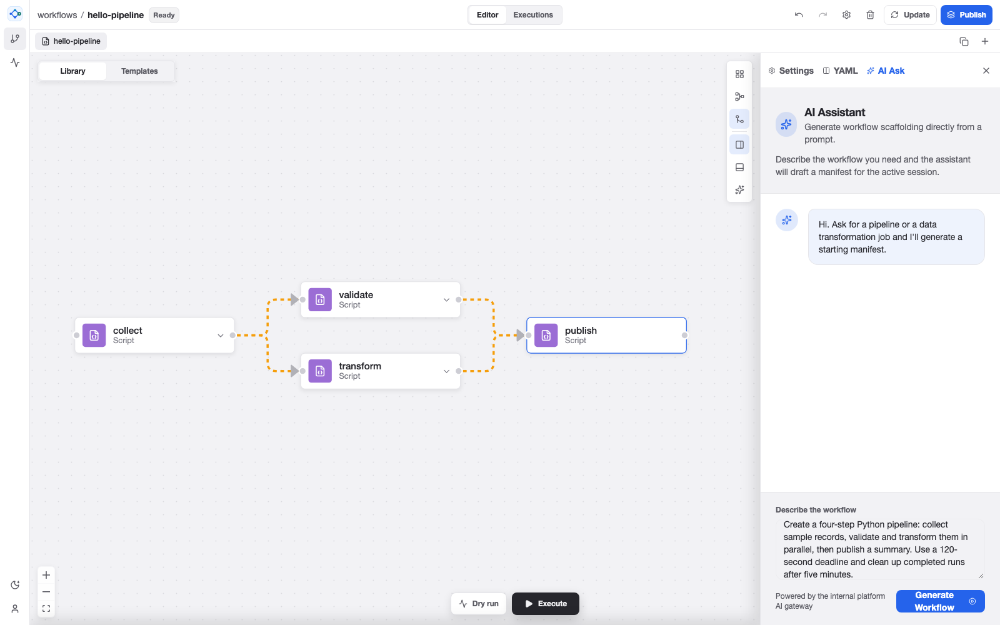

<picture>
  <source media="(prefers-color-scheme: dark)" srcset="apps/workflow-builder/public/brand/argocanvas-mark-dark.svg" />
  
</picture>

# ArgoCanvas

**Design visually. Run on Argo.**

ArgoCanvas is an independent visual editor for Argo Workflows. Connect steps on a canvas, inspect the YAML, reuse templates, and follow execution through status and logs. It connects to your existing Argo installation, with optional AI assistance for drafting and reviewing workflows.

[Get started](#quickstart) · [Deploy on Kubernetes](docs/production.md) · [Compatibility](docs/production.md#recorded-live-compatibility-check) · [Contribute](CONTRIBUTING.md) · [CI](https://github.com/thajj/ArgoCanvas/actions/workflows/ci.yaml) · [Report a bug](https://github.com/thajj/ArgoCanvas/issues)

[](docs/media/argocanvas-showcase.mp4)

[Watch the MP4 walkthrough](docs/media/argocanvas-showcase.mp4) · [View static screenshots — reduced motion](#workspace-tour)

*The walkthrough and screenshots show the compiled production app with editor permissions and AI integration enabled. Captions and gentle zooms guide the tour. Argo and Gemini responses come from deterministic sample services, using sample data and dummy credentials.*

## What you can do

- **Design workflows visually.** Connect steps, configure inputs and outputs, set retries and conditions, and organize work across draft tabs.
- **Work with YAML.** Import workflows, inspect generated manifests, and edit with locally bundled Monaco and Argo schema hints.
- **Operate Argo workflows.** Submit runs, inspect status and logs, suspend or resume workflows, and publish, update, and reuse WorkflowTemplates from the Templates library.
- **Keep your work.** Production drafts persist on disk per authenticated user, with browser recovery copies and visible save failures.
- **Use optional AI assistance.** Generate a workflow draft, analyze dependencies and configuration, or request a node edit through a server-side Gemini integration. Review generated changes before running them.

## Quickstart

Use **Node.js 24** and **pnpm 10.29.3**, the versions used by CI. `.nvmrc` selects Node 24, and `package.json` pins pnpm.

```sh
git clone https://github.com/thajj/ArgoCanvas.git
cd ArgoCanvas
pnpm install --frozen-lockfile
cp .env.example .env.local
pnpm dev
```

Open [http://127.0.0.1:3000](http://127.0.0.1:3000). You can explore the editor without a cluster. To connect development workflow requests to Argo, set `ARGO_ENDPOINT`, `ARGO_NAMESPACE`, and `ARGO_TOKEN` in `.env.local`, then restart the server. Optional AI requires both `GEMINI_API_KEY` and `GEMINI_MODEL`; choose a [currently available text model](https://ai.google.dev/gemini-api/docs/deprecations/) for your Google project. The same model handles generation, editing, and analysis. Bare IDs and `models/<ID>` names are accepted; see [.env.example](.env.example). Keep credentials in server-side variables, never variables prefixed with `VITE_`. Optional development links to the native Argo UI use `VITE_ARGO_UI_URL`.

**Development mode includes simulations.** Its gateway stores drafts and templates in memory and can return simulated successful workflow runs when Argo is unreachable. A successful development run is not evidence of cluster execution. Use the production gateway and deployment verification procedure for integration testing.

**Dry run** previews graph execution without running containers. **Execute** submits the generated workflow; **Submitted** means Argo accepted the request, not that execution finished. Open **View runs** or **Workflows** to follow the actual phase and logs.

Built-in workflow patterns are starting points: supply images, credentials, storage paths, and application-specific commands before submitting them. The [hello workflow](examples/hello-workflow.yaml) is a small example to inspect or import. It uses the `workflows` namespace; change its `metadata.namespace` to your configured `ARGO_NAMESPACE` before running it (`.env.example` defaults to `default`).

## Workspace tour

### Build the pipeline

Connect steps on the canvas and configure each node in the inspector. The sample pipeline collects records, validates and transforms them in parallel, then publishes a summary.



### Review the manifest

Inspect and edit the generated YAML alongside the graph. Monaco, its language workers, and the Argo schema are served by the application, with validation feedback before you apply edits.



### Draft with AI

Describe a pipeline in **AI Ask** to generate a starting manifest through the AI gateway. Use **Analyze with AI** for feedback on the current workflow, then review and adjust the draft before submitting it. Administrators enable this integration with a Gemini key and model; access follows the user's editor permissions.



*AI assistance enabled in the sample environment, backed by a deterministic Gemini fixture.*

## Deploy on Kubernetes

The [production deployment guide](docs/production.md) covers image builds, Kubernetes manifests, OIDC configuration, secrets, Argo RBAC, persistent storage, verification, backups, and rollback.

The production image serves the compiled application through a Node.js gateway behind an OAuth2 Proxy sidecar. The proxy authenticates with your OIDC provider; the gateway enforces viewer/editor groups, namespace scope, and same-origin writes. Argo credentials stay on the server. Production workflow requests use the real Argo API and report upstream failures.

```sh
docker build -t argocanvas:local .
kubectl kustomize deploy/kubernetes
```

The second command renders the example manifests for inspection. Replace the image, hostname, OIDC settings, ingress selectors, and storage configuration, and provision Secrets and TLS before applying them. `pnpm dev` and `vite preview` are development tools; deploy the published release image or build from the root `Dockerfile`.

### Current boundaries

- **Trusted team, one namespace.** Workflows, templates, and logs are shared within the deployment's namespace. Per-user drafts are isolated. Editor access permits executable Kubernetes workloads; runner RBAC and cluster admission remain essential.
- **One gateway replica.** Drafts use a persistent filesystem with one writer and last-save-wins semantics. The supplied deployment uses `Recreate`, so updates briefly interrupt service. Horizontal scaling requires a shared persistence design.
- **Visual editing supports a subset of Argo.** Importing a manifest into the graph and regenerating YAML can omit unsupported fields or simplify constructs. Review the resulting YAML before submission, especially for existing or advanced workflows. Argo performs the authoritative validation.

The [operations guide](docs/production.md#verification-and-operation) distinguishes automated fixture coverage from checks that must pass against your actual cluster and identity provider.

## Architecture

```text
Browser → TLS ingress → OIDC login proxy → Node.js gateway → Argo Server
                                               ├─ per-user drafts on a PVC
                                               └─ Gemini (optional)
```

The TypeScript workspace uses React, React Flow, Monaco, Vite, pnpm, and Turborepo:

- [`apps/workflow-builder`](apps/workflow-builder) — standalone host, production gateway, development gateway, and `mountWorkflowBuilder` / `unmountWorkflowBuilder` entry points.
- [`packages/workflow-editor`](packages/workflow-editor) — graph and YAML editors, workflow operations, and runtime clients.
- [`packages/workflow-domain`](packages/workflow-domain) — workflow types, parsing, generation, validation, layout, and simulation.
- [`packages/platform-sdk`](packages/platform-sdk) — host integration contracts, feature flags, permissions, events, and telemetry.
- [`packages/ui-platform`](packages/ui-platform) — shared theme and interface components.
- [`deploy`](deploy) — Kubernetes manifests and an example Argo client role.

## Development and verification

After installing dependencies:

```sh
pnpm lint                           # TypeScript checks across the workspace
pnpm test                           # Unit and integration tests
pnpm build                          # Compiled browser application and Node.js gateway
pnpm exec playwright install chromium
pnpm e2e                            # Browser tests against the compiled production server
pnpm audit:check                     # Dependency audit policy
pnpm test:oidc                       # Real OAuth2 Proxy with an ephemeral test issuer
```

Browser tests require `openssl` on `PATH` and port 3000 available. Linux may need `pnpm exec playwright install --with-deps chromium`. The OIDC check requires a running Docker daemon and access to the pinned proxy image. Test credentials and upstream services are temporary fixtures.

`pnpm check` runs the type-checks, tests, build, and browser suite together. `pnpm start` runs the compiled gateway after a build and requires the runtime configuration described in the deployment guide; it does not load `.env.local`.

The [CI workflow](.github/workflows/ci.yaml) checks the workspace, browser behavior, the restricted production container, and OIDC login/header handling.

**Recorded live compatibility check — October 23, 2026:** the compiled gateway passed workflow submission, completion, logs, resume/resubmit, and template lifecycle checks against **Argo Workflows 4.1.6** on **Kubernetes 1.37.0**, using **kind 0.33.0**. Artifact archiving and a real OIDC provider were outside this check's scope. See the [verification record and deployment checks](docs/production.md#recorded-live-compatibility-check) before using your own identity provider, policies, and workloads.

## Contributing and support

See [CONTRIBUTING.md](CONTRIBUTING.md) for the development workflow, checks, and pull-request guidance. Contributors are expected to adhere to the [Code of Conduct](CODE_OF_CONDUCT.md). Bug reports should include reproduction steps, the commit being tested, browser/runtime versions, and whether the problem occurs in development or production mode. Remove tokens, personal information, and sensitive workflow content before sharing logs or screenshots.

Use [GitHub Issues](https://github.com/thajj/ArgoCanvas/issues) for bugs and feature proposals. See [SECURITY.md](SECURITY.md) for security reporting and the project's current support status.

## License

Licensed under the [Apache License 2.0](LICENSE). Third-party dependencies retain their own licenses; provenance for the vendored Argo schema is documented [alongside the schema](apps/workflow-builder/public/schemas/README.md).

## Trademarks

ArgoCanvas is an independent project. It is not affiliated with, endorsed by, or sponsored by the Argo Project, the Cloud Native Computing Foundation, or The Linux Foundation. Argo is a trademark of The Linux Foundation. Gemini is a trademark of Google LLC.
