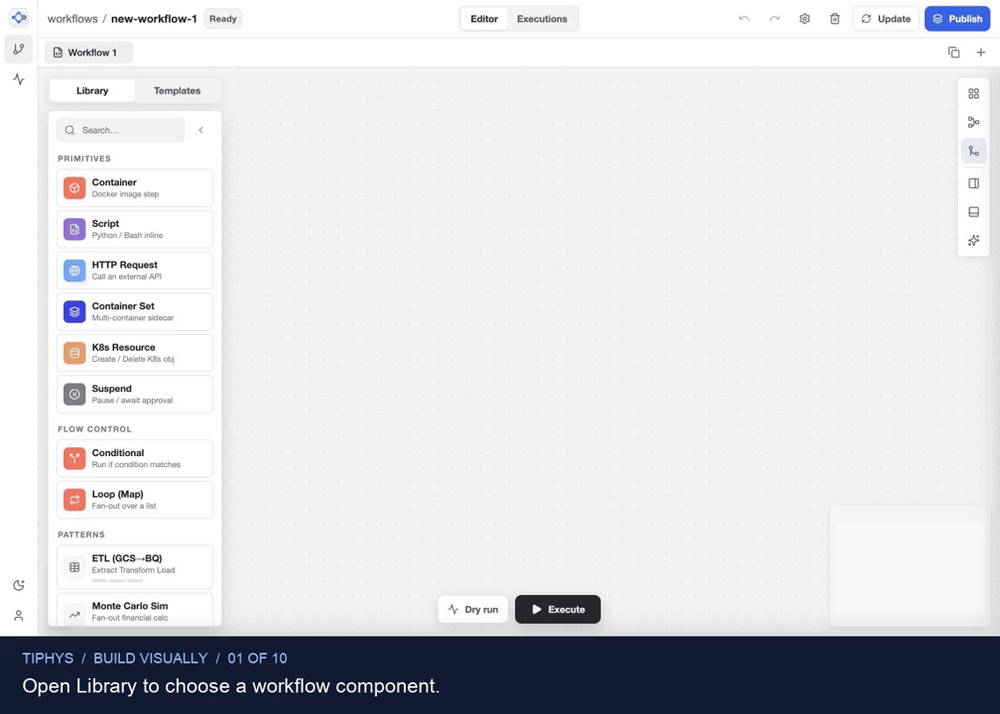

<picture>
  <source media="(prefers-color-scheme: dark)" srcset="apps/workflow-builder/public/brand/tiphys-mark-dark.svg" />
  
</picture>

# Tiphys

**Design visually. Run on Argo.**

Tiphys is an open-source visual editor for Argo Workflows. Drag components from the left-hand library, configure them, and draw connections without writing YAML. Or copy an existing Argo manifest, paste it onto the canvas, and start with its graph.

Inspect the generated YAML and follow runs through status and logs. Your existing Argo installation executes the workflows.

[Get started](#quickstart) · [Deploy on Kubernetes](docs/production.md) · [Compatibility](docs/production.md#recorded-live-compatibility-check) · [Contribute](CONTRIBUTING.md) · [CI](https://github.com/thajj/tiphys/actions/workflows/ci.yaml) · [Report a bug](https://github.com/thajj/tiphys/issues)

[](docs/media/tiphys-showcase.mp4)

[Watch the MP4 walkthrough](docs/media/tiphys-showcase.mp4) · [View static screenshots (no animation)](#workspace-tour)

*The step-by-step GIF uses captures of the real editor: three components added from Library, their settings and connections, then an official Argo YAML import. The visuals use the compiled app with editor permissions, sample services, and dummy credentials. No workloads were executed for this walkthrough. The AI screenshot uses a sample Gemini response.*

## Workspace tour

### Build a workflow without writing YAML

1. Open **Library** on the left. Drag a **Container**, an **HTTP Request**, and a **Suspend** component onto the empty canvas.
2. Select each node to configure it in the inspector. In this example, `prepare` uses `busybox:1.37` and the default `echo hello` command; `check-api` sends a GET request to `https://example.com`; `approve` has an empty duration so it waits for approval.
3. Draw connections between the nodes' output and input dots: `prepare` → `check-api` → `approve`. Use the layout controls to arrange the graph, then open **YAML** to inspect the generated manifest.


*The component library, connected graph, and configuration form stay in the same workspace. Node settings also include inputs, outputs, retries, and conditions.*

### Start from an official Argo YAML example

1. Open Argo's official [`dag-diamond.yaml`](https://github.com/argoproj/argo-workflows/blob/main/examples/dag-diamond.yaml) and click **Copy raw file**.
2. Click an empty area of the Tiphys canvas and paste with **Cmd+V** or **Ctrl+V**.
3. Choose **Open in New Tab** in the import dialog. Tiphys displays the four-step diamond: A branches into B and C, then both join at D. Your other draft stays open.
4. Select a node to change its settings, or open **YAML** to inspect and edit the manifest. Set the workflow namespace to match your Argo connection before submitting it.


*Copy a working example, paste it, and continue in the visual editor.*

Tiphys serves Monaco, its language workers, and the Argo schema locally, with validation feedback before you apply YAML edits. Visual editing supports a subset of Argo. Importing advanced YAML into the graph and regenerating it can drop unsupported fields or simplify constructs. Review the result before submission. Argo performs the final validation.

### Draft with AI

Use **AI Ask** to draft a workflow, **Analyze with AI** for feedback on dependencies and configuration, or **Edit with AI** to change a node. Administrators enable the server-side Gemini integration; access follows editor permissions. Review generated changes before running them.


*A prompt for a separate four-step pipeline, ready to generate a draft.*

## Quickstart

Use **Node.js 24** and **pnpm 10.29.3**, the versions used by CI. `.nvmrc` selects Node 24; `package.json` pins pnpm.

```sh
git clone https://github.com/thajj/tiphys.git
cd tiphys
pnpm install --frozen-lockfile
cp .env.example .env.local
pnpm dev
```

Open [http://127.0.0.1:3000](http://127.0.0.1:3000). You can explore the editor without a cluster. To connect services, edit `.env.local` using [.env.example](.env.example) as a reference, then restart:

- **Argo:** set `ARGO_ENDPOINT`, `ARGO_NAMESPACE`, and `ARGO_TOKEN`.
- **Optional AI:** set `GEMINI_API_KEY` and `GEMINI_MODEL`. Choose an [available text model](https://ai.google.dev/gemini-api/docs/deprecations/) for your Google project. The same model handles generation, editing, and analysis; both bare IDs and `models/<ID>` names work.
- **Optional Argo UI links:** set `VITE_ARGO_UI_URL` to the public URL of your Argo UI.

Keep credentials in server-side variables. Values prefixed with `VITE_` go into the browser bundle and must not contain secrets.

**Development mode includes simulations.** Drafts and templates live in memory, and the gateway can return simulated successful runs when Argo is unreachable. A successful request here does not confirm cluster execution. Use the production gateway and [deployment checks](docs/production.md#deployment-checks) to test your cluster integration.

Start with the [hello workflow](examples/hello-workflow.yaml). It uses the `workflows` namespace; set its `metadata.namespace` to your `ARGO_NAMESPACE` before submitting it (`.env.example` defaults to `default`). Built-in patterns also need your own images, credentials, storage paths, and application commands.

## Runs, templates, and drafts

Click **Execute** to submit a workflow. **Submitted** means Argo accepted the request. Open **View runs** or **Workflows** to check its actual phase and logs, or to suspend and resume it. **Dry run** simulates the graph without running containers.

Use **Publish** to create a WorkflowTemplate and **Update** to save changes. Find and reuse stored templates in the **Templates** library. Argo stores these resources in the cluster, and updates include the current resource revision so it can reject conflicting changes.

In production, Tiphys saves drafts on disk for each signed-in user and keeps recovery copies in the browser. The editor reports failed saves.

## Deploy on Kubernetes

The [deployment guide](docs/production.md) covers image builds, Kubernetes manifests, OIDC, secrets, Argo RBAC, storage, verification, backups, and rollback.

The production image serves the compiled app through a Node.js gateway behind an OAuth2 Proxy sidecar. The proxy authenticates with your OIDC provider. The gateway enforces viewer/editor groups, namespace scope, and same-origin writes, keeps Argo credentials on the server, and reports failures from the real Argo API.

```sh
docker build -t tiphys:local .
kubectl kustomize deploy/kubernetes
```

`kubectl kustomize` renders the example manifests for inspection. Before applying them, replace the image, hostname, OIDC settings, ingress selectors, and storage configuration, and provision Secrets and TLS. Deploy the published release image or build from the root `Dockerfile`; `pnpm dev` and `vite preview` are development tools.

### Current boundaries

- **Trusted team, one namespace.** Workflows, templates, and logs are shared within the namespace; drafts are isolated per user. Editors can submit executable Kubernetes workloads, so runner RBAC and cluster admission policies remain essential.
- **One gateway replica.** Draft storage uses one filesystem writer with last-save-wins semantics. The deployment uses `Recreate`, which causes brief downtime during updates. Horizontal scaling requires shared persistence.

## Architecture

```text
Browser → TLS ingress → OIDC login proxy → Node.js gateway → Argo Server
                                               ├─ per-user drafts on a PVC
                                               └─ Gemini (optional)
```

The TypeScript workspace uses React, React Flow, Monaco, Vite, pnpm, and Turborepo:

- [`apps/workflow-builder`](apps/workflow-builder): standalone host, production and development gateways, and `mountWorkflowBuilder` / `unmountWorkflowBuilder` entry points.
- [`packages/workflow-editor`](packages/workflow-editor): graph and YAML editors, workflow operations, and runtime clients.
- [`packages/workflow-domain`](packages/workflow-domain): workflow types, parsing, generation, validation, layout, and simulation.
- [`packages/platform-sdk`](packages/platform-sdk): host integration contracts, feature flags, permissions, events, and telemetry.
- [`packages/ui-platform`](packages/ui-platform): shared theme and interface components.
- [`deploy`](deploy): Kubernetes manifests and an example Argo client role.

## Development and verification

After installing dependencies:

```sh
pnpm lint                           # TypeScript checks across the workspace
pnpm test                           # Unit and integration tests
pnpm build                          # Compiled browser application and Node.js gateway
pnpm exec playwright install chromium
pnpm e2e                            # Browser tests against the compiled production server
pnpm audit:check                     # Dependency audit policy
pnpm test:oidc                       # Real OAuth2 Proxy with an ephemeral test issuer
```

Browser tests need `openssl` on `PATH` and port 3000 available. On Linux, you may need `pnpm exec playwright install --with-deps chromium`. The OIDC check needs Docker running and access to the pinned proxy image. Tests use temporary credentials and upstream fixtures.

`pnpm check` runs the type-checks, tests, build, and browser suite. After a build, `pnpm start` runs the compiled gateway with the [production runtime configuration](docs/production.md); it does not load `.env.local`.

The [CI workflow](.github/workflows/ci.yaml) checks the workspace, browser behavior, the restricted production container, and OIDC login/header handling.

**Recorded compatibility check (October 23, 2026):** the compiled gateway passed workflow submission, completion, logs, resume/resubmit, and template lifecycle checks against **Argo Workflows 4.1.6** on **Kubernetes 1.37.0**, using **kind 0.33.0**. The check did not cover artifact archiving or a real OIDC provider. Follow the [verification record and deployment checks](docs/production.md#recorded-live-compatibility-check) for your own identity provider, policies, and workloads; fixture tests alone do not verify your deployment.

## Contributing and support

Read [CONTRIBUTING.md](CONTRIBUTING.md) for the development and pull-request workflow, and follow the [Code of Conduct](CODE_OF_CONDUCT.md).

Use [GitHub Issues](https://github.com/thajj/tiphys/issues) for bugs and feature proposals. Include reproduction steps, the commit, browser/runtime versions, and whether you used development or production mode. Remove tokens, personal information, and sensitive workflow content from shared logs and screenshots. See [SECURITY.md](SECURITY.md) for security reporting and support status.

## License

Licensed under the [Apache License 2.0](LICENSE). Third-party dependencies retain their own licenses; provenance for the vendored Argo schema is documented [alongside the schema](apps/workflow-builder/public/schemas/README.md).

## Trademarks

Tiphys is an independent project. It is not affiliated with, endorsed by, or sponsored by the Argo Project, the Cloud Native Computing Foundation, or The Linux Foundation. Argo is a trademark of The Linux Foundation. Gemini is a trademark of Google LLC.
